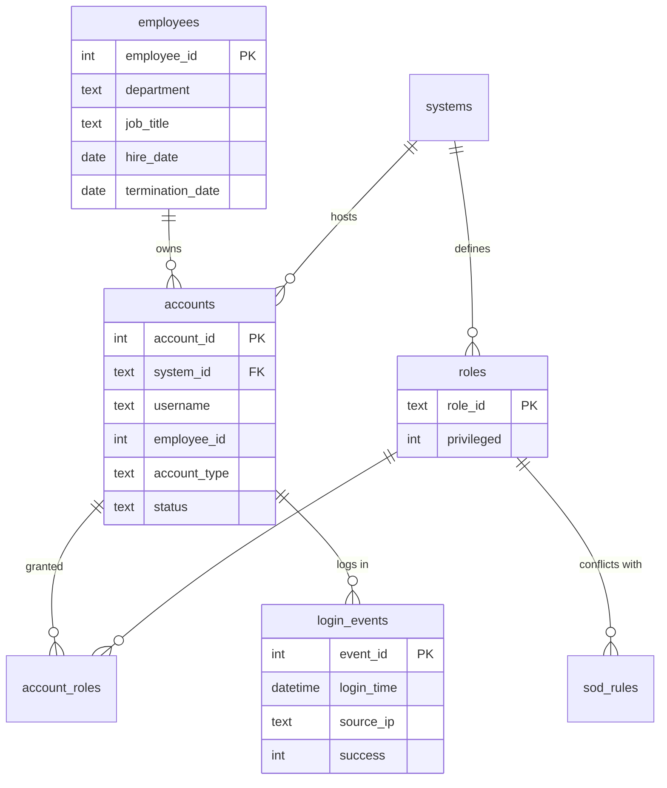

# IT Access Review Audit (SQL)

A simulated **user access review**, one of the most common tests in IT audit, performed entirely in SQL.

I acted as the IT auditor for **Ridgeline Logistics**, a fictional 180-person company, and tested whether system access across five applications matched HR records and the company's access policies. Eight SQL tests check the whole population (no sampling) and produce an audit report in standard **Condition / Criteria / Risk / Recommendation** format, mapped to **NIST CSF 2.0** and **ISO 27001**.

👉 **[Read the audit report](sample-output/audit_report.md)**

> All people, usernames and IP addresses are invented. The dataset is generated with a fixed seed, and a known set of control failures is planted in it, so each test can be checked for misses and false positives.

## Results

| ID | Control tested | Risk | Exceptions |
|---|---|---|---|
| AR-01 | Terminated employees still have enabled accounts | High | 6 accounts (3 people) |
| AR-02 | Successful logins after termination | High | 2 accounts |
| AR-03 | Segregation-of-duties conflicts | High | 4 people |
| AR-04 | Dormant accounts (90+ days unused) | Medium | 7 accounts |
| AR-05 | Administrator access held outside IT | High | 3 accounts |
| AR-06 | Orphaned accounts with no owner | Medium | 3 accounts |
| AR-07 | Shared or generic accounts | Medium | 2 accounts |
| AR-08 | Privileged logins outside business hours | Medium | 2 accounts |

`Verify.java` confirms every test finds exactly the planted issues: **no misses and no false positives** across 180 employees, 479 accounts and 17,063 login events.

## Data model



Systems in scope: Active Directory, ERP Financials, Payroll, CRM, and VPN.

## Run it

Needs **Java 17+**. The first run downloads the SQLite JDBC driver automatically.

```bash
./run.sh           # builds output/audit.db, runs all 8 tests, writes the report
./run.sh verify    # checks the results against the planted issues
```

On Windows, run these in WSL (Ubuntu) or Git Bash. You can also open the folder in IntelliJ (it reads `pom.xml`) and run `AuditRunner`.

Outputs:
- `output/audit_report.md`: the audit report
- `output/findings/AR-0X.csv`: every exception per test (opens in Excel)
- `output/audit.db`: the database. Open it in [DB Browser for SQLite](https://sqlitebrowser.org/) and run the queries yourself.

## How the Java runner works

[`AuditRunner.java`](src/main/java/audit/AuditRunner.java) connects to SQLite through **JDBC**, builds the database from `schema.sql` and `seed.sql`, then runs each file in `sql/tests/`. Every test file begins with comment lines like `-- @severity: High` and `-- @risk: ...`; the runner reads those with a regex and uses them to write the report. That keeps each control defined in one place: its SQL file. Results are written to CSV and to a Markdown report that GitHub renders.

[`Verify.java`](src/main/java/audit/Verify.java) re-runs each query and compares the results with the answer key (`data/planted_issues.json`), reporting any missed issue or false positive.

## The SQL

Each test in [`sql/tests/`](sql/tests) starts with the control's metadata (risk, criteria, recommendation, framework mapping) in comments, followed by the query. Techniques used:

| Technique | Where |
|---|---|
| Multi-table `JOIN`s against HR records | AR-01, AR-02, AR-05 |
| CTEs (`WITH`) | AR-03, AR-04, AR-07, AR-08 |
| Self-join to find people holding *both* roles in a pair | AR-03 |
| `LEFT JOIN ... IS NULL` anti-join | AR-04, AR-06 |
| Aggregation with `GROUP BY`, `COUNT(DISTINCT)`, `MAX` | AR-02, AR-04, AR-07, AR-08 |
| Date and time logic (`julianday`, `datetime` offsets, `strftime`) | AR-01, AR-04, AR-08 |
| Conditional aggregation (`SUM(condition)`, `CASE`) | AR-07, AR-08 |

## Audit design decisions

- **SoD is tested per person, not per account.** Someone could hold one role in one system and the conflicting role under another account. AR-03 resolves every role to its employee before comparing.
- **No double counting.** Terminated users' accounts are reported in AR-01, so AR-04 (dormant) only looks at current employees.
- **Service accounts are scoped out where they'd create noise.** They have no human owner and run nightly jobs by design, so they're excluded from AR-06 and AR-08.
- **AR-02 is escalated, not just reported.** A login after termination means the access gap was actually used, which is a potential security incident.
- **Exceptions are leads, not conclusions.** In a real engagement, each would go to the system owner for a response before the report is final.

## Project structure

```
sql/schema.sql                       table definitions
sql/tests/0X_*.sql                   the eight audit tests
src/main/java/audit/AuditRunner.java runs the audit, writes the report
src/main/java/audit/Verify.java      checks for misses and false positives
data/seed.sql                        the generated dataset
data/planted_issues.json             answer key used by Verify
tools/generate_data.py               optional helper that created the fake data
run.sh                               compile + run
sample-output/audit_report.md        example report
```
